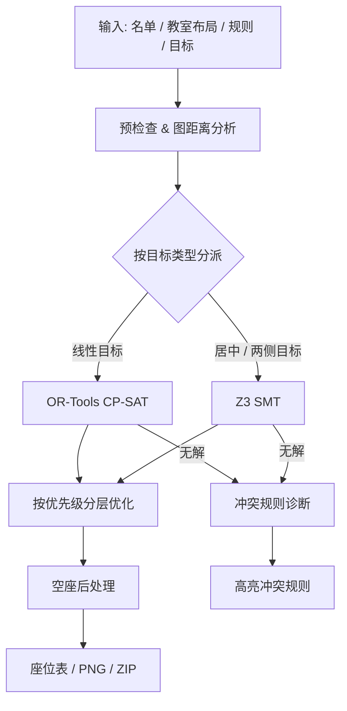

<p align="center">
  
</p>

<h1 align="center">PokeSeats 戳座</h1>

<p align="center">
  <strong>基于离散数学理论开发的高效完备的排座位工具</strong>
</p>

<p align="center">
  <a href="https://github.com/SECTL/PokeSeats/releases/latest"></a>
  
  
  <a href="LICENSE"></a>
</p>

---

## 📖 概述

排座位这件事，条件一多手工排起来就很折磨：近视的要往前调，动了一个又牵连好几个，最后效果还没法保证。PokeSeats 把排座写成约束求解问题——硬性规则（隔几个人、跟谁不能坐、固定坐哪）作为硬约束，身高梯度、各排均衡这类诉求按优先级逐层优化，求解器在每一层都证明了最优之后才继续下一层，最终给出全局最优的座位表。条件互相冲突、解不出来的时候，还会指出具体是哪几条规则在打架。

求解默认走 Google OR-Tools 的 CP-SAT；遇到居中或两侧分布类的距离目标就交给 Microsoft Z3，冲突诊断也靠 Z3 的不可满足核心（UNSAT Core）。一个几十人的教室基本秒出结果。

---

## ⚡ 技术架构与求解管线

项目分两层：求解核心（PokeSeats.Core）和 ImGui 桌面端，中间通过插件契约解耦。求解管线的流程：



### 1. 双求解引擎

* **OR-Tools (CP-SAT)**：默认引擎。目标能展开成整数线性约束时走它，剪枝效率高，速度也最快。
* **Z3**：目标含居中或两侧分布类距离函数时走它；无解时提取不可满足核心（UNSAT Core），告诉你是哪几条规则互斥导致的。

### 2. 按优先级分层优化

不做加权打分，按优先级从高到低一层层解：

1. 先满足全部硬约束；
2. 每层把高一层已锁定的最优值固化成边界条件，再继续优化本层目标，同级目标合并处理；
3. 业务目标都达成后，做一轮空座后处理：把散在前排的空座往后收，横向摊开别挤在一堆。

---

## ✨ 核心特性

### 🏛️ 教室布局

* 支持 1×1 到 32×32 任意规模网格，自由画课桌、讲台、宽走道和窄走道。
* 邻接关系可选同排左右、前后左右（四向）、前后左右及斜角（八向）；带"走道穿透"语义，能分清同桌紧挨和隔一条走道两种情况。

### 📐 排座规则

* 固定座位、区域容纳 / 区域禁入。
* 双人关系：后方 N 步以内、同排、同列、四向邻接、方向约束，全部支持取反。
* 任意一排或一列的人数下限、上限或固定值。

### 📊 名单与优化目标

* 名单以不可变快照（`RosterSnapshot`）承载，支持自定义学生属性：数值（可设单位和上下界）、分类和布尔三种类型，缺失值与零、否分开处理。通过原生 JSON 导入的名单会保留属性定义和稳定 ID，可完整往返。
* 目标类型：
  * **梯度**：按行、列或到某处的距离递增 / 递减。
  * **居中 / 靠外**：数值越大越居中（或越靠外侧）。
  * **排级均衡（RowBalance）**：按每行实际容量配比，让各行属性总量尽量平均。
  * **区域偏好（RegionPreference）**：给特定群体（比如弱视）指定想坐或不想坐的区域。

### 📦 导出与兼容

* 座位表渲染成高清 PNG（内置 HarmonyOS Sans SC），讲台朝向、单元格颜色、批注都能调。
* 一键导出 ZIP 快照（`students.json` / `rules.json` / `seating.json`），可重现名单、规则和座位分配。
* 名单支持 Excel、CSV、JSON 导入；CSV 和原生 JSON 格式可保留前导零与 GUID。

---

## 🖥️ 运行环境

* **Windows 7 SP1 (带 Platform Update) 及以上**
* **Linux x64 (glibc 体系)**，已在 WSLg 环境验证
* Windows 上需要支持 DirectX 11 的环境
* Linux 上需要支持 OpenGL 的环境（如 Mesa 显卡驱动）

Windows 与 Linux 发布包均自带 .NET 运行时，解压即用，不必单独安装。Windows 包还附带 x64 `d3dcompiler_47.dll`，来自 Windows SDK 的 Redist 目录，用于启动时编译界面着色器；请保留在 EXE 同级目录。

---

## 🚀 快速上手

### 直接运行

1. 去 [GitHub Releases](https://github.com/SECTL/PokeSeats/releases/latest) 或 [思拓创联 STK](https://stk.sectl.cn/PokeSeats/) 下载对应系统的发布包（如 `PokeSeats-win-x64.zip`）。
2. 解压到任意目录，双击 `PokeSeats.UI.exe` 即可.

### 典型操作流程

1. **载入名单**：在「学生名单」面板导入 Excel、CSV 或 JSON 名单。
2. **绘制教室**：在「教室布局」画布里框选划定课桌、走道和讲台。
3. **定规则和目标**：在「规则编辑」里加硬性排除 / 相邻约束，在「排座目标」里配身高梯度或各排均衡策略。
4. **求解导出**：点菜单栏「开始自动排座」，结果出来后一键导出高清排座图或 ZIP 快照。

Beta 功能的使用方式与说明见 [BETA.md](BETA.md)。按 `Ctrl + Alt + Shift + X` 可打开工作区选择器，切换到标签向导工作区。

---

## 🛠️ 从源码构建

需要 .NET 6 SDK；Windows 构建还需 Windows SDK 的 `Redist/D3D/x64/d3dcompiler_47.dll`，构建及发布时会自动复制到输出根目录。SDK 不在默认位置或从其他系统交叉发布 Windows 包时，可用 `-p:D3DCompilerPath=<DLL 完整路径>` 指定。底层求解器使用 64 位原生库，目标平台为 x64。

```bash
# 1. 克隆代码仓库
git clone https://github.com/SECTL/PokeSeats.git
cd PokeSeats

# 2. 还原依赖并编译 (需要联网拉取原生求解器 NuGet 包)
dotnet build PokeSeats.sln -c Release

# 3. 运行桌面宿主
dotnet run --project PokeSeats.UI -c Release --no-build
```

### 发布

可以按目标系统打独立部署包（自动剔除调试符号和多余的原生资产）：

```bash
# Windows x64 独立包
dotnet publish PokeSeats.UI -c Release -r win-x64 --self-contained true -o publish/win-x64

# Linux x64 独立包 (glibc 体系，需显式指定 ubuntu-x64 以匹配 Z3 动态库分发)
dotnet publish PokeSeats.UI -c Release -r ubuntu-x64 --self-contained true -o publish/linux-x64
```

---

## 🧩 模块划分

```text
PokeSeats/
├── PokeSeats.IR                    # 领域模型: 规则 AST、名单快照、教室网格
├── PokeSeats.Core                  # 求解: 图距离分析、CP-SAT 展开、Z3 展开、UNSAT 诊断
├── PokeSeats.UI.PluginContracts    # 插件契约: 设计令牌、DPI 缩放、扩展点 API
├── PokeSeats.UI                    # 桌面宿主: D3D11 / OpenGL 渲染、插件加载
├── PokeSeats.UI.DefaultWorkspace   # 默认工作区: 停靠布局、主菜单、主题
├── PokeSeats.UI.DefaultPayload     # 内置功能: 名单管理、布局编辑器、规则编辑、排座目标、结果面板、导出
├── PokeSeats.UI.Betapayload        # Beta 功能插件，见 BETA.md
└── PokeSeats.UI.TestPlugin         # 示例插件，不随发布分发
```

> 插件系统的扩展说明见 [PokeSeats.UI/PLUGIN.md](PokeSeats.UI/PLUGIN.md)。

---

## 📄 许可与致谢

本项目以 **GPL-3.0-or-later** 开源，条款见 [LICENSE](LICENSE)。

### 依赖

* **求解器**：[Google OR-Tools](https://github.com/google/or-tools) (Apache-2.0)、[Microsoft Z3](https://github.com/Z3Prover/z3) (MIT)
* **图形**：[Dear ImGui](https://github.com/ocornut/imgui) / [ImGui.NET](https://github.com/ImGuiNET/ImGui.NET) (MIT)、[Silk.NET](https://github.com/dotnet/Silk.NET) (MIT)
* **图像导出**：[SixLabors.ImageSharp](https://github.com/SixLabors/ImageSharp) / [ImageSharp.Drawing](https://github.com/SixLabors/ImageSharp.Drawing) (Apache-2.0)、[SixLabors.Fonts](https://github.com/SixLabors/Fonts) (Apache-2.0)、[StbImageSharp](https://github.com/StbSharp/StbImageSharp) (MIT)
* **数据导入**：[NPOI](https://github.com/nissl-lab/npoi) (Apache-2.0)、[hyjiacan.pinyin4net](https://github.com/hyjiacan/Pinyin4Net) (MIT)
* **字体**：随程序分发的 `HarmonyOS Sans SC` 版权归华为技术有限公司所有，按 [HarmonyOS Sans Fonts License Agreement](PokeSeats.UI/Fonts/Assets/LICENSE_Fonts) 分发。

---

<p align="center">
  <sub>Designed & Crafted by SECTL Studio (思拓创联) & chenjintang-shrimp.</sub>
</p>
